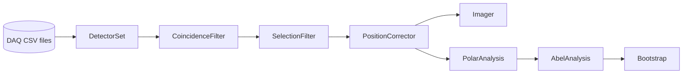

<h1 align="center">EVA</h1>
<p align="center"><b>E</b>lectron–neutral <b>V</b>MI <b>A</b>nalysis<br>
live and offline analysis for the electron–neutral coincidence velocity-map-imaging experiment at
<a href="https://www.desiree-infrastructure.com/experiments">DESIREE</a>
(Double ElectroStatic Ion Ring ExpEriment), Stockholm</p>

<p align="center">
<a href="#quick-start">Quick start</a> ·
<a href="#what-eva-does">Features</a> ·
<a href="#documentation">Documentation</a> ·
<a href="#citing-and-license">Citing</a>
</p>

EVA reads the detector CSV files written by the DAQ (`RA<det>_<date>.<time>.csv`) – while they grow, or afterwards –
finds the electron–neutral coincidences, and turns the electron images into radial intensities and anisotropy
parameters, with error bands. It is a Python/Qt successor of the author's C++/ROOT program (see
[Acknowledgements](#acknowledgements)) and works both through a **GUI** and as a plain **Python library**.

---

## What EVA does

| Step | What it gives you |
|---|---|
| **Coincidences** | pulse matching between the two detectors, pair search, accidentals from the laser-shot sidebands |
| **Cuts** | charge-sum and event-time cuts, before or after the coincidence search, with background-subtracted weights |
| **Position correction** | removes the dependence of the electron hit position on the neutral position and on dt (including timing walk) |
| **Images** | detector images, centring, circularisation |
| **Abel inversion** | rBASEX inversion to $I(\rho)$ and the anisotropy parameters $\beta_n(\rho)$, with optional corrections: statistical weights, smoothness, positivity, maximum entropy |
| **Errors** | bias-corrected bootstrap bands on $I(\rho)$ and every $\beta_n(\rho)$ |
| **Files** | one HDF5 file with the raw data, every setting, the results and the data of every plot; it can be opened again for **offline analysis** |

## Quick start

```bash
pip install -r requirements.txt                      # numpy, scipy, pandas, h5py, PyQt6, pyqtgraph

python main.py --demo                                # replay examples/test_data, no hardware needed
python main.py --demo --theme light                  # dark is the default
python main.py --dir <daq folder> --a 3 --b 1 --start    # your own data: detector A (electrons) and B (neutrals)
python main.py --file <RA003_..csv> --a 3 --b 2 --start  # one run, picked by any of its files
python main.py                                       # or pick everything in the window
```

**Without a window** – every operation of the GUI is available on the core objects:

```python
import sys; sys.path.insert(0, "src")
from session import Session, SessionConfig

s = Session(SessionConfig(directory="examples/test_data", det_a=3, det_b=1))
s.start()                                            # the stages work in background threads
# ... wait for the data ...
print(s.coincidence().summary())                     # results are immutable snapshots
s.abel.set_loss("a", entropy=0.3)                    # settings are thread-safe setters
s.stop()
```

See [`docs/gui.md`](docs/gui.md) for what each part of the window does with the matching code, and
[`examples/`](examples/README.md) for complete scripts (online analysis, offline analysis, analysis files, bootstrap).

## How the pieces talk



Each stage runs in its own worker thread and publishes **immutable results**; the GUI polls them every 200 ms and draws
them (`gui/plotdata.py` turns results into arrays, `pyqtgraph` draws). There are no locks and no Qt signals across
threads. User input goes the other way through small thread-safe setters (`sel.set_sum`, `flt.set_window`,
`img.set_mode`, `abel.set_loss`, ...).

## Documentation

| | |
|---|---|
| [`docs/gui.md`](docs/gui.md) | the tabs, step by step, each with the equivalent code: cuts, coincidence, position correction, centring, circularisation, Abel inversion, regularisation, bootstrap |
| [`docs/file-format.md`](docs/file-format.md) | saving, offline analysis and the layout of the HDF5 file |
| [`examples/README.md`](examples/README.md) | non-GUI example scripts |
| [`docs/notes/main.pdf`](docs/notes/main.pdf) | the notes: the mathematics (rBASEX, imaging, errors, calibration); source `docs/notes/main.tex`, references `Bibliography.bib` |

The notes are built in `docs/notes` with `pdflatex main.tex → biber main → pdflatex main.tex` (biblatex with the biber
backend; needs a full TeX Live: biblatex-phys, dsfont, bbm, mathdots, physics).

## Project layout

```text
main.py                       starts the GUI
src/
  session.py                  owns the pipeline; demo mode; offline mode (raw data from an analysis file); no Qt
  paths.py                    project locations
  daq/
    data_loader.py            tails the CSV files (live, partial lines, resets) -> snapshots
  analysis/
    coincidence.py            pulse matching, clock map, pair search, accidentals (laser-shot sidebands)
    filters.py                Sum / event-time cuts, before or after coincidence, true-pair weights
    poscorr.py                hit position of the pairs versus dt: correlation, correction, timing walk
    poscorr_stage.py          live stage: the correction as per-event displacements for the imagers
    imaging.py                a,b,c,d -> x,y -> transform -> binning -> image (Cartesian and polar binning)
    polar.py                  centring, circularisation (estimate, save/load), polar images; live stage
    abel.py                   Abel inversion in the notation of docs/notes/main.tex; I(rho), beta_n
    abel_loss.py              further loss terms: statistical weights, smoothness, non-negativity, maximum entropy
    abel_analysis.py          live Abel stage: events -> radial bins d_n(r) -> I(rho), beta_n(rho); runs the bootstraps
    bootstrap.py              bias-corrected bootstrap of I(rho) and every beta_n(rho) (Poisson weights, background thread)
  storage/
    h5file.py                 the analysis file (HDF5): layout, atomic write, read, the /README text in the file
    plots.py                  the data of every plot of the program under readable names (/plots)
    tree.py                   settings / results (dataclasses, arrays) <-> HDF5 groups, no class-by-class code
    capture.py                Session -> content of the file; saved settings -> stages
    static_source.py          the raw data of a file as a data source for the same pipeline
    saver.py                  background saving, only when something changed
  gui/
    main_window.py            source strip, file strip (save / open), tabs, status bar, refresh timer
    tab_detectors.py          tab 1
    tab_coincidence.py        tab 2 (timing page, position-correlation page)
    tab_polar.py              tab 3 "Analysis": centring, circularisation, Abel inversion (two pages of plots)
    plotdata.py               results -> arrays for each plot; no Qt
    widgets.py                ImagePlot, HistPlot, CutPlot (draggable cut lines)
    gui_state.py              value of every input widget <-> dict (stored in the analysis file)
    theme.py                  dark / light palette (Qt + pyqtgraph)
tools/fake_daq.py             replays recorded runs as a live DAQ (for testing and demos)
examples/                     non-GUI examples; examples/test_data/ has two recorded runs (detectors 1 and 3)
docs/                         gui.md, file-format.md; notes/ has main.tex / main.pdf and Bibliography.bib
```

## Notation

The mathematics is written up in [`docs/notes/main.pdf`](docs/notes/main.pdf). `src/analysis/abel.py` uses its
notation, so formulas and code can be read side by side:

| `main.tex` | `abel.py` |
|---|---|
| $\rho,\ \theta'$ (3D); $r,\ \theta$ (detector) | `rho`, `r`, angle from the laser axis |
| $n$, angular order (power of $\cos$) | `orders` |
| $d_{nr}$, radially binned data | `d[n, r]`, from `RadialBinner.d(weights)` |
| $H_{rni}$, inverse Hankel matrix per radius | `AbelBasis.H[r, n, i]` (`hankel_matrix` gives the Hankel part `K`) |
| $p_n^{T}$, $(p_n^{T})^{-1}$ | `AbelBasis.pT[n, r, R]`, `AbelBasis.pT_inv[n, R, r]` |
| $I_{n\rho} = \sum_j (p^{T})^{-1}_{\rho j;n} \sum_i H_{jni} d_{ij}$ | `get_angular_intensity(d)` → `I_n` |
| $C$, $C^{-1}$ | `AbelBasis.C`, `AbelBasis.C_inv`; `get_legendre_coefficients(I_n)` |
| $I(\rho) = 4\pi\rho^2 L_{0}$, $\beta_n = L_n/L_0$ | `AbelResult.intensity`, `AbelResult.beta` |

## Citing and license

EVA is released under the [MIT License](LICENSE): free to use, modify and distribute, as long as the copyright notice is
kept. If you use it for a publication, please also cite it (see [`CITATION.cff`](CITATION.cff); GitHub shows a
**Cite this repository** button) and the methods papers below.

## Acknowledgements

EVA continues
**[VMI-RAE-MCP-coincidense-DA-program](https://github.com/NikolajKlinkby/VMI-RAE-MCP-coincidense-DA-program)** by
Nikolaj Klinkby, the C++/ROOT analysis of velocity-map images recorded with an MCP and resistive anode encoder, from
which this Python/Qt version grew. The analysis chain is that program's design: centring from the projections by
convolution, radial circularisation, an rBASEX-type Abel inversion built on Hankel matrices, and the bias-corrected
bootstrap for the errors. What is new is that it runs live, combines the stages in one program with a GUI, and stores
the whole analysis in one file.

The methods are described in [`docs/notes/main.pdf`](docs/notes/main.pdf) and rest on:

* M. Ryazanov, *Development and implementation of methods for sliced velocity map imaging*, PhD thesis, University of
  Southern California (2012): the rBASEX basis set.
* B. Efron, *Better Bootstrap Confidence Intervals*, J. Am. Stat. Assoc. (1987),
  [doi:10.1080/01621459.1987.10478410](https://doi.org/10.1080/01621459.1987.10478410): the bias-corrected bootstrap.
