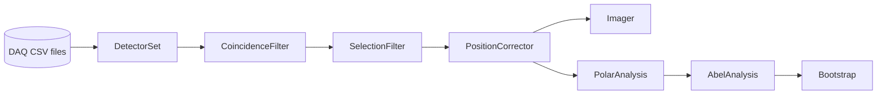

# EVA GUI guide

What every part of the window does, and how to do the same from a Python script with the core (no Qt).

Every section has the same three parts:

| | |
|---|---|
| **What you see** | the plots and what they show |
| **Controls** | what the inputs do |
| **In code** | the same operation on the core objects; the snippets run top to bottom and continue from each other |

**Contents**

1. [The core in a nutshell](#1-the-core-in-a-nutshell)
2. [Main window: source and file strips](#2-main-window-source-and-file-strips)
3. [Tab "Detectors"](#3-tab-detectors)
4. [Tab "Coincidence"](#4-tab-coincidence) – timing page, position-correlation page
5. [Tab "Analysis"](#5-tab-analysis) – events and binning, centring, circularisation, Abel inversion, regularisation, bootstrap
6. [Saving and offline analysis](#6-saving-and-offline-analysis)
7. [Centring and circularisation in detail](#7-centring-and-circularisation-in-detail)

---

## 1. The core in a nutshell

The GUI is a thin layer over a `Session`. The session owns the pipeline; each stage runs in its own worker thread,
publishes **immutable** results, and takes new settings through small thread-safe setters. A script (or the GUI,
every 200 ms) only reads results and calls setters – no locks, no signals.



| In the window | Stage object | Read the result with |
|---|---|---|
| raw data (source strip) | `s.ds` – `DetectorSet` | `s.ds.snapshot()` |
| Tab 2, timing page | `s.flt` – `CoincidenceFilter` | `s.coincidence()` |
| Tab 1, cuts | `s.sel` – `SelectionFilter` | `s.selection()` |
| Tab 2, position correlation | `s.pos` – `PositionCorrector` (+ `analysis.poscorr`) | `s.position_correction()` |
| Tab 1, images | `s.img` – `Imager` | `s.imaging()` |
| Tab 3, centring, circularisation | `s.polar` – `PolarAnalysis` | `s.polar_result()` |
| Tab 3, Abel inversion, bootstrap | `s.abel` – `AbelAnalysis` | `s.abel_result()` |

**Setup used by all snippets below** (run them from the project folder). The stages read the files in the background, so after starting (or after
changing a setting) you wait until the result you need exists. `wait_for` is a three-line helper for that.

```python
import sys, time
sys.path.insert(0, "src")                                   # the project's packages live in src/

from session import Session, SessionConfig

def wait_for(condition, timeout=300):
    """The stages work in their own threads: poll until `condition()` is true."""
    t0 = time.time()
    while not condition() and time.time() - t0 < timeout:
        time.sleep(0.3)
    return condition()

s = Session(SessionConfig(directory="examples/test_data",   # folder with RA<det>_<date>.<time>.csv
                          det_a=3, det_b=1,                 # A: filtered and imaged first, B: its partner
                          bins=128))
s.start()

def abel_ready(side="a"):
    r = s.abel_result()
    return r is not None and r[side].abel is not None and r[side].n_events > 0

wait_for(abel_ready)
A, B = s.config.det_a, s.config.det_b
print(s.status_line())
```

The same code follows a **live** DAQ folder while the files grow: nothing changes except that the results keep
updating. `python examples/01_online_analysis.py` is a complete script for that.

> **Tip.** Results are snapshots. Keep a reference (`r = s.abel_result()`) while you work with it; ask again for a
> newer one. Each result has a `version` that increases whenever anything it depends on changed.

---

## 2. Main window: source and file strips

**What you see.** The first strip chooses the data, the second saves and opens analysis files; the status bar shows
`s.status_line()`.

**Controls**

| Control | Meaning | `SessionConfig` field |
|---|---|---|
| folder / `browse...` | folder with the DAQ files | `directory` |
| detector A / B | A is filtered and imaged first (usually the electron detector), B is its partner | `det_a`, `det_b` |
| run | `latest` or a run stamp such as `20260624.130138` | `run` |
| search window | half-width of the pair search in dt | `search_window_us` |
| shot period | nominal period of the laser-shot structure | `shot_period_us` |
| bins | image size | `bins` |
| demo | replay `examples/test_data` as a live run | `demo_source`, `demo_speed` |
| Start / Stop | `s.start()` / `s.stop()` | |

**In code**

```python
print(s.status_line())          # the text of the status bar
print(s.errors())               # [] while every worker thread is healthy

# a live-looking run from recorded files: the same files are replayed into a temporary folder
demo = Session(SessionConfig(directory="", demo_source="examples/test_data", demo_speed=50, det_a=3, det_b=1))
demo.start()
wait_for(lambda: demo.coincidence() is not None)
demo.stop()
```

Saving and opening files is covered in [section 6](#6-saving-and-offline-analysis).

---

## 3. Tab "Detectors"

**What you see.** One row per detector: *image | event time | charge sum*.

* The time and Sum plots have two draggable vertical lines (tick **cut**, drag them, or type the numbers).
* **Grey** = all events, **orange** = true coincidence pairs (background subtracted, independent of the cuts),
  **blue** = events kept by all cuts.

**Controls**

| Control | Effect |
|---|---|
| image mode | `subtracted` (accidentals subtracted, the default), `raw` (events that pass the cuts), `all` |
| Sum cut: before / after coincidence | `pre`: cut first, then search partners; `post`: search first, cut afterwards |
| coincidence on / off | without it only the cuts decide |
| fit image range | set the image range around the data once (then it stays fixed, so images stay comparable) |

**In code – cuts.** Detectors are addressed by their number or by `"a"` / `"b"`. The time cut always acts last.

```python
s.sel.set_sum(A, 2000, None)                  # Sum >= 2000 on detector A, before the coincidence search
s.sel.set_sum(B, 1000, 50000, stage="post")   # a window on B, applied after it
s.sel.set_time(A, 10, 100)                    # only events 10 .. 100 s after A's first event
s.sel.auto_sum(B, (0.02, 0.98))               # or: limits follow quantiles of B's true-pair Sum spectrum
s.sel.use_coincidence(True)

wait_for(lambda: s.selection().settings == s.sel.settings)
sel = s.selection()
print(sel.settings.describe(A, B))
for label, n_a, n_b in sel.cutflow:           # the cut flow shown under the plots
    print(f"{label:<45s} A {n_a:>8}  B {n_b:>8}")

s.sel.clear_sum(A); s.sel.clear_sum(B); s.sel.clear_time(A)       # back to "no cuts" for the next sections
```

**In code – the arrays behind the plots**

```python
wait_for(lambda: s.selection().settings == s.sel.settings)
sel = s.selection()
x, counts = sel.histogram(A, "sum", kind="true", bins=100)    # kinds: all | true | selected | raw
t, counts = sel.histogram(A, "time", kind="selected", bins=100)
print(sel.show(A, "sum", kind="true", lines=8))               # a quick terminal histogram

from gui.plotdata import detector_panel                       # exactly what the tab draws, as arrays
panel = detector_panel(s.selection(), s.imaging(), A)
print(panel.n_valid, panel.n_selected, panel.cut_sum, panel.centroid)
```

**In code – images**

```python
from analysis.imaging import CartesianBinning

s.img.set_mode("subtracted")                                  # "raw" | "all"
s.img.set_binning(CartesianBinning(256, 256), A)              # only detector A (det=None: both)
wait_for(lambda: s.imaging() is not None)
binning = s.img.fit_range(A, quantiles=(0.1, 99.9))           # 'fit image range'; returns the new binning
wait_for(lambda: s.imaging()[A].binning == binning)

img = s.imaging()[A]
print(img.summary())
print(img.image.shape, img.total, img.centroid())             # img.image[iy, ix]; img.binning.extent for plotting
print(img.ascii(20))
```

---

## 4. Tab "Coincidence"

### 4.1 Timing page

**What you see**

* dt overview over the whole search window, with the main window and the control windows
* dt zoom (drag the window there), window vs control-window counts
* pair rate vs time and the clock-drift residual
* a text summary: peak, window, accidentals, true pairs

The time difference is $\mathrm{dt} = t_B - t_A$. The accidentals are estimated from **control windows**: copies of the main
window shifted by whole laser-shot periods (default ±1, ±2).

**Controls**

| Control | Meaning | Call |
|---|---|---|
| search window, cycle shift | re-searches everything | `s.restart_coincidence(search_window_us=..., cycle_shift=...)` |
| nominal period | refined from the data | `s.flt.set_shot_period(us)` |
| control windows | which shifts are used | `s.flt.set_bkg_shots((-2, -1, 1, 2))` |
| automatic window width | in peak sigmas | `s.flt.set_auto_sigma(3.0)` |
| manual window | | `s.flt.set_window(lo, hi)` / `s.flt.clear_window()` |

**In code**

```python
coin = s.coincidence()
print(coin.summary())                       # the text box of the page
print(coin.peak(), coin.window_us)          # (centre, sigma) in us, and the window in effect
st = coin.window_stats()
print(st["pairs"], st["acc"], st["acc_fraction"])      # pairs in the window, accidentals, their fraction

centres, counts = coin.histogram(bin_us=1.0, range_us=(-50, 100))   # the dt overview
dt, ta = coin.dt_us, coin.ta                # every pair: dt [us] and the A-clock time [s]

s.flt.set_window(19.5, 25.0)                # a manual window ...
wait_for(lambda: s.coincidence().window_us == (19.5, 25.0))
print(s.coincidence().window_stats()["pairs"])
s.flt.clear_window()                        # ... back to automatic
s.flt.set_bkg_shots((-1, 1))                # only the nearest control windows
s.flt.set_bkg_shots((-2, -1, 1, 2))

s.restart_coincidence(search_window_us=1500)    # a new search window needs a full re-search
wait_for(lambda: s.coincidence() is not None and s.coincidence().search_window_us == 1500)
s.restart_coincidence(search_window_us=2500)
wait_for(lambda: s.coincidence() is not None and s.coincidence().search_window_us == 2500)
```

The panel the tab draws, as arrays:

```python
from gui.plotdata import coincidence_panel
cp = coincidence_panel(s.coincidence())
print(cp.true_pairs, cp.acc_fraction, cp.drift_ppm)
```

### 4.2 Position-correlation page

Switch it on with **enable position correlation** (default off; the page then computes nothing and nothing is
passed on). It studies how the *hit position* of a coincidence pair depends on dt and on the other detector's
position, and can remove that dependence.

**What you see** (one plot per detector, plus the right-hand column)

* the hit position $x$ (left axis, blue) and $y$ (right axis, orange) of the pairs against dt: binned means with
  standard errors, optionally a subsample of the individual pairs
* the electron image of the window before and after the correction, and the corrected image for 1–6 equal slices of
  dt (on the fixed detector grid of tab 1)
* the fitted parameters with errors and t-values, and the corrected mean position of every slice

**The model.** Inside the coincidence window the corrected electron position is

$$
\mathbf r_\mathrm{corr} \;=\; \mathbf r_e \;-\; M\,\mathbf r_n \;-\; f(\tau) \;-\; \mathbf d ,
$$

where $\mathbf r_e$ is the electron hit position, $\mathbf r_n$ the neutral hit position (coupled through the $2\times2$
matrix $M$), $\tau$ the time difference dt and $f$ a polynomial in $\tau$; $\mathbf d$ keeps the mean position. The fit is
weighted: pairs in the window count $+1$, pairs in each of the $K$ control windows $-1/K$ (moved into the window in dt),
so only true coincidences determine $M$ and $f$.

**Controls**

| Control | Meaning |
|---|---|
| dt range, bin width | the window of the position-vs-dt plots |
| subtract accidentals in the means | each bin counts its pairs $+1$ and the same bin shifted by each control window $-1/K$ |
| electron detector | which detector is corrected (default A) |
| neutral position ($M$) | include the $M\,\mathbf r_n$ term |
| dt polynomial order | 0 = none, 1 = $c\,\tau$, higher orders are shrunk slightly so they stay stable |
| weighted fit | subtract accidentals in the fit |
| apply Sum / time cuts of tab 1 | only pairs whose two events pass the cuts |
| show corrected position (dashed) | the means after the correction; a trend left over is the residual dt dependence |
| correct dt for the hit positions | **timing walk**: fit $\mathrm{dt} = \mathrm{const} + \mathbf k\cdot\mathbf p$ ($\mathbf p$ = hit positions) inside the peak ($\pm N\sigma$) and replace dt by $\mathrm{dt} - \mathbf k\cdot(\mathbf p - \bar{\mathbf p})$ for the whole page |
| pass the correction on to the Analysis tab | run the correction in the pipeline (below) |

The text box reports "flat in dt? $\chi^2/\mathrm{dof}$" of $x_e$ and $y_e$ before and after the correction
(10 equal dt bins; 1 = flat).

**In code – the analysis functions of the page** (`analysis.poscorr`; they work on a coincidence result and the
raw-data snapshot it was made from)

```python
from analysis import poscorr

snap, coin = s.ds.snapshot(), s.coincidence()

prof = poscorr.dt_profile(coin, snap, A, B, half_us=20, bin_us=0.5)        # position vs dt; {'a': ..., 'b': ...}
p = prof["a"]
print(p.centers.shape, p.weight.sum(), p.mean_x[40], p.err_x[40])   # true pairs, mean x and its error

cor = poscorr.fit_correction(coin, snap, A, B, side_e="a", use_neutral=True, tau_order=1)
print(cor.text())                                                          # the parameter box
print(cor.M, cor.c, cor.std_before, cor.std_after)

images = poscorr.correction_images(coin, snap, A, B, cor, s.img.settings.binning_a, n_slices=3)
print(images.text())                                                       # uncorrected / corrected / slices

walk = poscorr.fit_walk(coin, snap, A, B, n_sigma=2.0)                     # None if there is no peak
print(walk.text() if walk else "no walk fit")
```

**In code – passing the correction on.** Every electron row that sits in a pair of the window (or of a control
window, for the accidental subtraction) is displaced before the images, the centring, the circularisation and the
Abel inversion see it. Rows without a partner and the neutral detector are not touched; the page itself always shows
the raw positions.

```python
s.pos.configure(enabled=True, side_e="a", use_neutral=True, tau_order=1, walk=False)
wait_for(lambda: s.position_correction() is not None and s.position_correction().enabled
         and s.position_correction().correction is not None)
print(s.position_correction().text)

s.pos.configure(enabled=False)               # off again
wait_for(lambda: not s.position_correction().enabled)
```

---

## 5. Tab "Analysis"

Settings for every operation on the left (collapsible sections), two pages of plots on the right.

* **Page "centring and circularisation"** – image after centring (+ circularisation), angle-integrated radial profile,
  radial bins $d_n(r)$ after and before circularisation, centring diagnostics, circularisation $s(\theta)$.
* **Page "Abel inversion"** – measured (angular-binned) image, reconstructed image, radial bins $d_n(r)$,
  intensity $I(\rho)$, anisotropy $\beta_n(\rho)$, and a summary.

Everything is **per detector** (`"a"` or `"b"`).

### 5.1 Events and polar binning

**Controls**

| Control | Meaning | Call |
|---|---|---|
| events | `subtracted` (weights with the accidentals subtracted), `raw`, `all` | `s.polar.set_mode(...)` |
| radial bins, angular bins, $r_\mathrm{max}$ | the polar histogram (angular bins are rounded to a multiple of 4) | `s.polar.set_binning(side, nr=, ntheta=, r_max=)` |
| fit $r_\mathrm{max}$ | from the radius of the selected events | `s.polar.fit_r_max(side)` |

```python
s.polar.set_mode("subtracted")
s.polar.set_binning("a", nr=200, ntheta=96)
s.polar.fit_r_max("a")                          # r_max from the data (99.9th percentile of the radius, padded)
wait_for(lambda: s.polar_result()["a"].binning.r_max == s.polar.settings.a.r_max)

pa = s.polar_result()["a"]
print(pa.binning, pa.raw.shape)                 # polar histogram [angle, radius]; .corr = with circularisation
```

### 5.2 Centring

The centre is estimated live from the x and y projections (see [section 7](#7-centring-and-circularisation-in-detail)).
**auto** follows the estimate, **manual** takes the numbers typed in; **lock** freezes the current centre.

```python
print(pa.center, pa.center_auto, pa.center_mode)       # in use / latest estimate / "auto" or "manual"
print(pa.warnings)                                     # e.g. a centre that differs from the circularisation table

s.polar.set_estimator("a", "convolution")              # or "centroid"
s.polar.lock_center("a")                               # freeze what is in use ...
s.polar.set_center("a", *pa.center)                    # ... or type a centre (switches to manual)
s.polar.set_center_mode("a", "auto")                   # follow the estimate again
```

### 5.3 Circularisation

Fits a stretch factor $s$ per angular bin so that the rings become circles. It is computed **on request**, never on
every update, and applied to every event's angle.

| Control | `CircParams` field |
|---|---|
| reference slice, direction | `theta_ref_deg`, `direction` |
| matching range | `r_lo`, `r_hi` |
| allowed stretch | `s_min`, `s_max` |
| smoothing, max. step per bin | `smooth_bins`, `max_step` |
| harmonics (0 = every bin as fitted) | `harmonics` |

```python
from analysis.polar import CircParams

s.polar.compute_circularisation("a", CircParams(harmonics=2), wait=True)    # runs in a worker thread
print(s.polar.status("a"))                      # e.g. the fitted stretch range and similarity
s.polar.save_circ("a", "circ_a.json")           # human-readable JSON table s(angle)
print(s.polar.load_circ("a", "circ_a.json"))    # list of compatibility warnings (centre, detector, binning)

s.polar.enable_circ("a", False)                 # keep the table, switch it off
s.polar.enable_circ("a", True)
s.polar.clear_circ("a")                         # forget it
```

### 5.4 Abel inversion

*What you see* (page "Abel inversion"): the radial bins $d_n(r)$ (order $n$ = power of $\cos\theta$), the intensity

$$
I(\rho) = 4\pi\rho^2\,L_0(\rho)
$$

in counts per unit radius, and the anisotropy parameters

$$
\beta_n(\rho) = \frac{L_n(\rho)}{L_0(\rho)} .
$$

$L_n$ are the Legendre coefficients of the angular distribution. Order 1 is not expected for a mirror-symmetric distribution but is kept
by default: it absorbs small asymmetries of the data.

| Control | Meaning | Call |
|---|---|---|
| highest order, even orders only | which $d_n$ are used (default 0, 1, 2) | `s.abel.set_orders(side, n_max=, even_only=)` |
| laser axis angle | direction of the axis, counter-clockwise from +x | `s.abel.set_axis_angle(side, degrees)` |
| Tikhonov damping | 0 = exact inverse; > 0 damps (per order) | `s.abel.set_regularisation(side, tikhonov, diff_order)` |
| beta shown above | $\beta$ is left out where $I(\rho)$ is below this fraction of its maximum | `s.abel.set_min_intensity(side, fraction)` |

```python
def peak(a):                                     # strongest bin where beta is defined
    import numpy as np
    ok = np.isfinite(a.abel.beta).all(axis=0)
    return int(np.argmax(np.where(ok, a.abel.intensity, -np.inf)))

ab = s.abel_result()["a"]
print(ab.status, ab.n_events, ab.orders)
print(ab.abel.intensity.shape, ab.abel.I_n.shape, ab.abel.beta.shape)       # (R,)  (N, R)  (N-1, R)
i = peak(ab)
print(f"I(rho) peaks at rho = {ab.rho[i]:.4g}; beta{ab.abel.beta_orders} = {ab.abel.beta[:, i]}")

v = s.abel_result().version
s.abel.set_orders("a", n_max=4, even_only=True)                              # orders 0, 2, 4
s.abel.set_axis_angle("a", 90.0)
s.abel.set_min_intensity("a", 0.02)
wait_for(lambda: s.abel_result().version > v and abel_ready())
print(s.abel_result()["a"].orders)
```

The same plots as arrays, exactly as drawn:

```python
from gui.plotdata import abel_panel
panel = abel_panel(s.abel_result(), "a", s.polar_result()["a"].binning)
print(panel.text)                                # the summary box
print(panel.rho.shape, panel.intensity.x.shape)  # I(rho)
```

### 5.5 Regularisation (corrections to the inversion)

The plain (rBASEX) inverse reproduces the measured moments exactly, noise included, which shows up as **ringing**: a
negative dip of $I(\rho)$ in front of a peak. All corrections are collected in the section **Regularisation (corrections
to the inversion)** between "Abel inversion" and "Bootstrap". A bold line at its top states in words which of them
are applied. They are numbered as in the window:

| # | Correction | What it does | Call |
|---|---|---|---|
| 1 | **Tikhonov damping** | general damping per angular order | `set_regularisation(side, tikhonov)` |
| 2 | **statistical weights** | data weighted with their covariance (estimated from the events, accidentals included); noisy radii and orders are smoothed more than well-determined ones. Changes nothing without a penalty or constraint | `set_loss(side, weighting=True)` |
| 3 | **smoothness of $I(\rho)$** | penalty on the curvature (`smooth_order=2`) or gradient (`1`) of $I(\rho)$, optionally also of the other orders (`smooth_all`); the strength is relative | `set_loss(side, smooth=0.3)` |
| 4 | **non-negativity** | `"intensity"`: $I(\rho)\ge 0$. `"distribution"`: the full angular distribution $\sum_n I_n\cos^n\theta \ge 0$ at every radius and 16 angles (ADMM) | `set_loss(side, positivity="intensity")` |
| 5 | **maximum entropy** | soft positivity from Poisson counting statistics (below) | `set_loss(side, entropy=0.3)` |

Items 2–5 act on all orders and radii together (`analysis/abel_loss.py`, needs scipy). Weights and smoothness keep the
inversion linear, so a bootstrap costs the same as before; non-negativity makes every sample an optimisation
(256 resamples with "distribution" take about 10 s more; with "intensity" next to nothing).

**Maximum entropy.** Adds the penalty

$$
\alpha^2 F^2 \sum w\; s\!\left(\frac{f}{F}\right), \qquad s(x) = x\ln\frac{x}{m} - x + m ,
$$

the entropy of a positive additive distribution, on the angular distribution $f$ at every radius and 16 angles. $F$ is its
peak, $\alpha$ the strength and $m$ the **default level** (percent of the peak, `entropy_floor`); where the data say nothing, $f$ relaxes to it. The curvature $1/f$ makes
weak tails stiff and strong peaks soft, as counting noise is. It replaces the hard constraint (the two cannot be
combined) and combines with 1–3. The data term stays the $\chi^2$ with the event covariance, because the Abel moments are
weighted sums with negative accidental-subtraction weights, not counts. One damped Newton optimisation per sample
(about 15 steps). Where $f$ reaches the floor numerically (a pronounced dip), $\beta$ is undefined, as for the hard
constraint.

```python
def compare(label):
    wait_for(lambda: abel_ready())
    time.sleep(2)                                  # let the settings propagate through the pipeline
    wait_for(lambda: abel_ready())
    a = s.abel_result()["a"]
    print(f"{label:<28s} {a.basis.loss_text()}")

s.abel.set_orders("a", n_max=2, even_only=False)
s.abel.set_loss("a", weighting=True, smooth=0.3, smooth_order=2)     # 2 + 3
compare("weights + smoothness")

s.abel.set_loss("a", weighting=False, smooth=0.0, positivity="intensity")   # 4
compare("I(rho) >= 0")

s.abel.set_loss("a", positivity="off", entropy=0.3, entropy_floor=0.01)     # 5 (excludes 4)
compare("maximum entropy")

s.abel.set_loss("a", entropy=0.0)                                     # all corrections off: the exact inverse
s.abel.set_regularisation("a", 0.0)
compare("plain inverse")
```

`python examples/03_change_settings.py` compares all variants on the example data, and
`examples/08_abel_inversion_synthetic.py` shows on a synthetic ring with known answers why the corrections exist.

### 5.6 Bootstrap (bias corrected)

The section **Bootstrap** (and `AbelAnalysis.start_bootstrap`) resamples the data of the current Abel result and shows
a bias-corrected interval of $I(\rho)$ and of every $\beta_n(\rho)$ as a shaded band on the two plots; the text
summary quotes the interval at the maximum of $I(\rho)$. It always uses the corrections of the Abel result it resamples.

| Part | How it works |
|---|---|
| **Resampling** | every event weight (1, or the background-subtraction weight: positive in the coincidence window, negative in the control windows) is multiplied by an independent Poisson(1) number, so the noise of the accidental subtraction is part of the error. `event`: one number per event; `cycle`: one per Sync-Time cycle (about 1 s), which keeps correlations within a cycle |
| **Interval** | per radial bin: $z_0 = \Phi^{-1}(\text{fraction of bootstrap values below the measured one})$, then the quantiles at $\Phi(2z_0 \mp z)$ of the sorted values ($z=1$ for $\pm1\sigma$, 68.3 %). Asymmetric around the measurement; no acceleration constant (as in the C++ program). Bins where $\beta$ is undefined have no interval |
| **Speed and liveness** | runs on a frozen copy of the events in a background thread and publishes its progress (the bands grow). About 1000 resamples of 100 k weighted events take 5 s. The bands are only drawn when the settings of the Abel result are those of the run; "re-run when the data grew by 10 %" starts a new run by itself |
| **Memory** | all samples are kept: 2000 samples of 200 bins and orders 0, 1, 2 are about 10 MB; at most 50 000 samples in the interface |

```python
s.abel.set_bootstrap("a", n_boot=300, unit="event", n_sigma=1.0)    # also: auto=True, growth=0.10
s.abel.start_bootstrap("a", seed=1)
wait_for(lambda: not s.abel.bootstrap_running("a"), timeout=600)

b = s.abel.bootstrap_result("a")
ab = s.abel_result()["a"]
i = peak(ab)
print(b.summary(i))                                                  # the text the tab shows
print(f"I(rho) at the peak: {b.intensity.estimate[i]:.4g}  [{b.intensity.lower[i]:.4g}, {b.intensity.upper[i]:.4g}]")
for j, n in enumerate(b.beta_orders):
    print(f"beta_{n}: {b.beta.estimate[j, i]:+.3f}  [{b.beta.lower[j, i]:+.3f}, {b.beta.upper[j, i]:+.3f}]")
print(b.intensity_samples.shape, b.beta_samples.shape)               # every sample is kept

# any number of resampled weight vectors can be inverted without touching the live state
import numpy as np
w = ab.weights * np.random.default_rng(0).poisson(1.0, len(ab.weights))
print(ab.resample(w).intensity.shape)
```

`examples/07_bootstrap.py` is the complete script, including saving the bands.

---

## 6. Saving and offline analysis

**What you see.** The second strip of the window: **save analysis to file** (toggle, file name, folder), **save now**
and **open saved file (offline analysis)...**. While data come in the file is rewritten every N seconds (only if
something changed) and when the session stops. The file holds the raw data, every setting, the results and the data of
every plot – see [`file-format.md`](file-format.md) for its layout.

**Offline analysis** re-runs the whole pipeline on the raw data of a file, with every setting restored; everything can
be changed and saved again.

**In code** (needs `h5py`)

```python
from storage import capture, h5file

snap = capture.capture(s, comment="EVA guide")           # session -> content of the file
h5file.write_file("analysis.h5", snap)                   # written to .part, then renamed (atomic)
s.stop()

info = h5file.read_meta("analysis.h5")                   # settings, configuration, widget state
c = info["config"]
off = Session(SessionConfig(directory="", det_a=c["det_a"], det_b=c["det_b"], bins=c["bins"],
                            search_window_us=c["search_window_us"], shot_period_us=c["shot_period_us"],
                            offline_file="analysis.h5"))  # the raw data come from the file
off.preset = info["settings"]                              # applied before the stages start
off.start()
wait_for(lambda: off.abel_result() is not None and off.abel_result().a.abel is not None)
print(off.status_line())
off.abel.set_loss("a", entropy=0.3)                      # change the analysis after the fact
off.stop()
```

---

## 7. Centring and circularisation in detail

**Centring.** Project the image on $x$ and $y$; the self-convolution of a projection that is symmetric about $c$ peaks at
$2c$, and the peak is refined with a parabola. Automatic (live) or manual / locked.

**Circularisation** (on request, never on every update). A stretch factor $s$ per angular bin (events move
$r \to s\,r$) is fitted on the polar histogram. The reference slice defines two mirror planes; the first quadrant is fixed
by chaining each bin to its predecessor, and all other bins are matched to their mirror image in that quadrant.
Safeguards you can switch off: a limit on the change per bin, optional smoothing onto $\cos(2n\varphi)$ harmonics, a fit
similarity per bin and a count of bins stuck at the search limits.

The result is a table $s(\theta)$. It is applied to every event's angle (smooth, periodic interpolation), so it does not
depend on the angular binning of any image: change the binning freely, or load a table made with another number of
angular bins. What does matter is the centre (stored in the table; the tab warns if it differs) and the detector.

**Saved table** (JSON, human readable): format/version, detector, centre, reference angle and sweep direction, fit
range, `n_theta`, `theta_deg[]`, `stretch[]`, `similarity[]`.
